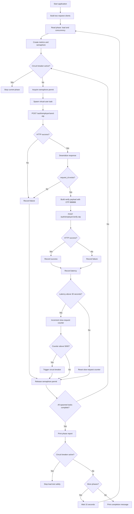

# Employer OTP Load Testing

This Rust-based load-testing tool tests the employer OTP login flow with large request volumes.
Each virtual user executes a two-step authentication flow:

1. Sends an OTP request.
2. Verifies the OTP using the returned `request_id`.

For every phase, the tool reports the concurrency limit, success/failure counts,
average latency, and throughput. If very high latency continues, the circuit breaker
stops the test safely.

## Features

- Asynchronous, high-concurrency execution with Tokio
- End-to-end testing of the employer OTP login flow
- Phase-wise load and concurrency configuration
- HTTP connection pooling and TCP keep-alive
- Progress logging after every 10,000 initiated users
- Average latency and throughput calculation
- High-latency circuit breaker
- Separate modules for DTOs and virtual-user logic

## Project Structure

```text
app_load_testing/
├── Cargo.toml
├── Cargo.lock
└── src/
    ├── main.rs          # Builds HTTP clients and runs test phases
    ├── virtual_user.rs  # Virtual-user OTP flow, concurrency, and metrics
    └── dto.rs           # Request and response payload structures
```

## Requirements

- Rust and Cargo
- A Rust 2021 edition-compatible toolchain
- A running API gateway
- The following endpoints must be available on the gateway:

```text
POST http://127.0.0.1:8001/auth/employer/send-otp
POST http://127.0.0.1:8001/auth/employer/verify-otp
```

## API Payloads

### Send OTP request

```json
{
  "phone_number": "+919999900000",
  "role": "EMPLOYER"
}
```

The response must contain either `request_id` or `requestId`:

```json
{
  "request_id": "request-id-from-server"
}
```

### Verify OTP request

```json
{
  "phone_number": "+919999900000",
  "request_id": "request-id-from-server",
  "otp_code": "888888"
}
```

> The OTP `888888` is hard-coded in the current implementation. Change it to the
> dummy OTP configured for your test or staging environment.

## Configuration

The gateway URL is loaded from a local `.env` file:

```env
GATEWAY_URL=http://127.0.0.1:8001
```

Copy `.env.example` to `.env` and change `GATEWAY_URL` when using a different
gateway. The `.env` file is ignored by Git so local configuration and secrets
are not committed. Do not store production credentials or real user data in the
source code.

## Load Phases

The current phases in `main.rs` are:

| Phase | Virtual users | Concurrency |
|---|---:|---:|
| 1 | 100,000 | 100 |
| 2 | 200,000 | 150 |
| 3 | 500,000 | 200 |
| 4 | 1,000,000 | 250 |

There is a 15-second cooldown between phases to give Windows connections and
ports time to clean up.

### Phase execution rules

- A phase creates `total_load` virtual users.
- A Tokio semaphore limits active tasks to the configured `concurrency`.
- Each virtual user generates a unique phone number:

  ```text
  +9199999{user_id padded to 5 digits}
  ```

- If the OTP send or verify step fails, the flow is counted as a failure.
- The test moves to the next phase only if the circuit breaker has not been triggered.

## Flow Diagram



### Flow summary

```text
main.rs
  └── execute_phase(...)
        ├── semaphore concurrency limit
        ├── spawn virtual-user task
        │     ├── send OTP
        │     ├── receive request_id
        │     ├── verify OTP
        │     └── update metrics
        ├── await all tasks
        ├── print phase report
        └── start next phase or stop safely
```

## Metrics and Circuit Breaker

The following counters are maintained for each phase:

- `total_success`: Successful OTP verification flows
- `total_failures`: Network errors, non-success statuses, invalid JSON, or missing `request_id`
- `total_latency_ms`: Measured latency from sending the verify request until receiving its response
- `slow_requests_count`: Requests with latency above 30 seconds

Circuit breaker conditions:

```text
MAX_LATENCY_THRESHOLD = 30 seconds
CIRCUIT_BREAKER_LIMIT = 5000 slow requests
```

When the slow-request counter exceeds the limit, new work stops and the complete
load test ends safely after the phase report. The slow counter resets when a
request completes within the latency threshold.

## Run

From the project directory:

```bash
cargo run --release
```

To compile and check the project:

```bash
cargo check
```

To check formatting:

```bash
cargo fmt --all -- --check
```

> This tool generates a very large load. Run it only against a local, staging,
> or explicitly approved test environment.

## Sample Console Output

```text
=== STARTING PHASE 1: 100000 Requests (Concurrency: 100) ===
Progress: 10000/100000 requests initiated. (Success: 8120, Failures: 420)

--- PHASE 1 FINAL REPORT ---
Total Execution Time : 2m 14s
Successful Flows     : 81200
Failed Flows         : 18800
Total Completed      : 100000 / 100000
Avg Latency Per User : 742 ms
Throughput           : 746.27 full_flows/sec
```

## Real Test Execution Results

> **Verified during an actual load-test run:** The results below were captured
> from a real execution of this load-testing tool against the configured API
> gateway. They are not sample or simulated values.

### Phase 1 — Completed

| Metric | Observed result |
|---|---:|
| Total requests | 100,000 |
| Concurrency | 100 |
| Total execution time | 191.5168102 seconds |
| Successful flows | 100,000 |
| Failed flows | 0 |
| Total completed | 100,000 / 100,000 |
| Average latency per user | 190 ms |
| Throughput | 522.15 full flows/second |

The run also showed the following progress timings:

| Progress point | Successful flows | Failures | 10,000-request block time |
|---|---:|---:|---:|
| 10,000 / 100,000 | 9,901 | 0 | 7.23 seconds |
| 20,000 / 100,000 | 19,901 | 0 | 14.94 seconds |
| 30,000 / 100,000 | 29,901 | 0 | 21.09 seconds |
| 40,000 / 100,000 | 39,901 | 0 | 21.24 seconds |
| 50,000 / 100,000 | 49,901 | 0 | 21.05 seconds |
| 60,000 / 100,000 | 59,901 | 0 | 21.07 seconds |
| 70,000 / 100,000 | 69,901 | 0 | 21.08 seconds |
| 80,000 / 100,000 | 79,901 | 0 | 21.27 seconds |
| 90,000 / 100,000 | 89,901 | 0 | 21.13 seconds |

### Phase 2 — In Progress at Capture Time

The following values were captured while Phase 2 was still running. This is
partial progress data, not the final Phase 2 report:

| Metric | Observed result |
|---|---:|
| Planned requests | 200,000 |
| Concurrency | 150 |
| Progress captured | 20,000 / 200,000 |
| Successful flows at 10,000 | 9,851 |
| Successful flows at 20,000 | 19,851 |
| Failures at captured checkpoints | 0 |
| 10,000-request block time at 10,000 | 21.75 seconds |
| 10,000-request block time at 20,000 | 25.49 seconds |

The complete Phase 1 console output was:

```text
=== 🚀 STARTING PHASE 1: 100000 Requests (Concurrency: 100) ===
📊 Progress: 10000/100000 requests initiated. (Success: 9901, Failures: 0) | ⏱️ Time taken for this 10k block: 7.23s
📊 Progress: 20000/100000 requests initiated. (Success: 19901, Failures: 0) | ⏱️ Time taken for this 10k block: 14.94s
📊 Progress: 30000/100000 requests initiated. (Success: 29901, Failures: 0) | ⏱️ Time taken for this 10k block: 21.09s
📊 Progress: 40000/100000 requests initiated. (Success: 39901, Failures: 0) | ⏱️ Time taken for this 10k block: 21.24s
📊 Progress: 50000/100000 requests initiated. (Success: 49901, Failures: 0) | ⏱️ Time taken for this 10k block: 21.05s
📊 Progress: 60000/100000 requests initiated. (Success: 59901, Failures: 0) | ⏱️ Time taken for this 10k block: 21.07s
📊 Progress: 70000/100000 requests initiated. (Success: 69901, Failures: 0) | ⏱️ Time taken for this 10k block: 21.08s
📊 Progress: 80000/100000 requests initiated. (Success: 79901, Failures: 0) | ⏱️ Time taken for this 10k block: 21.27s
📊 Progress: 90000/100000 requests initiated. (Success: 89901, Failures: 0) | ⏱️ Time taken for this 10k block: 21.13s

📊 --- PHASE 1 FINAL REPORT ---
⏱️  Total Execution Time : 191.5168102s
✅ Successful Flows     : 100000
❌ Failed Flows         : 0
🏁 Total Completed      : 100000 / 100000
📉 Avg Latency Per User : 190 ms
⚡ Throughput           : 522.15 full_flows/sec
---------------------------------
```

## Important Notes

- This application is not an API server; it is an API client and load generator.
- `client_send` and `client_verify` are separate clients so the send and verify
  flows remain independent.
- The `reqwest` request timeout is 30 seconds.
- `pool_max_idle_per_host(500)` and TCP keep-alive help reuse HTTP connections.
- The current implementation reads only `request_id` from the response body; the
  remaining DTO fields are retained for response compatibility.
- Verify the API gateway, OTP behavior, and test-data policy before starting the load test.
